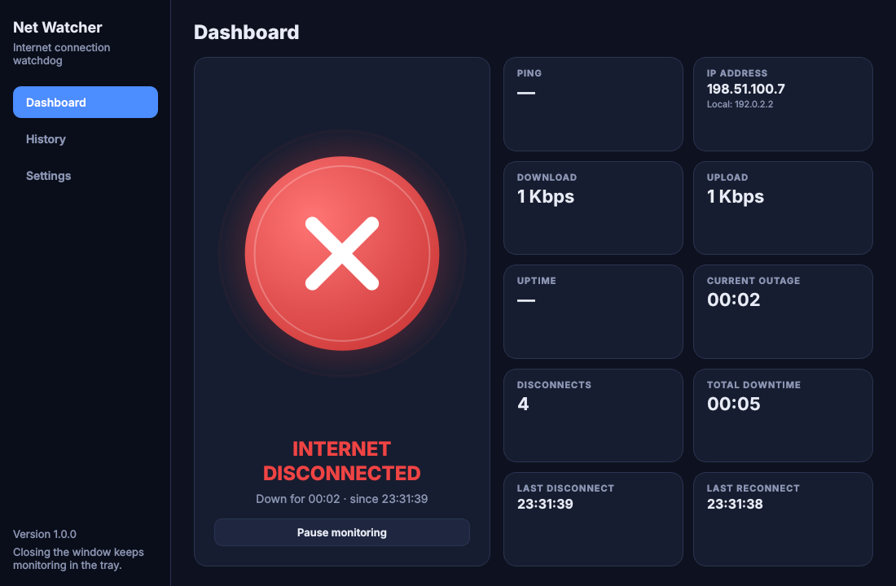
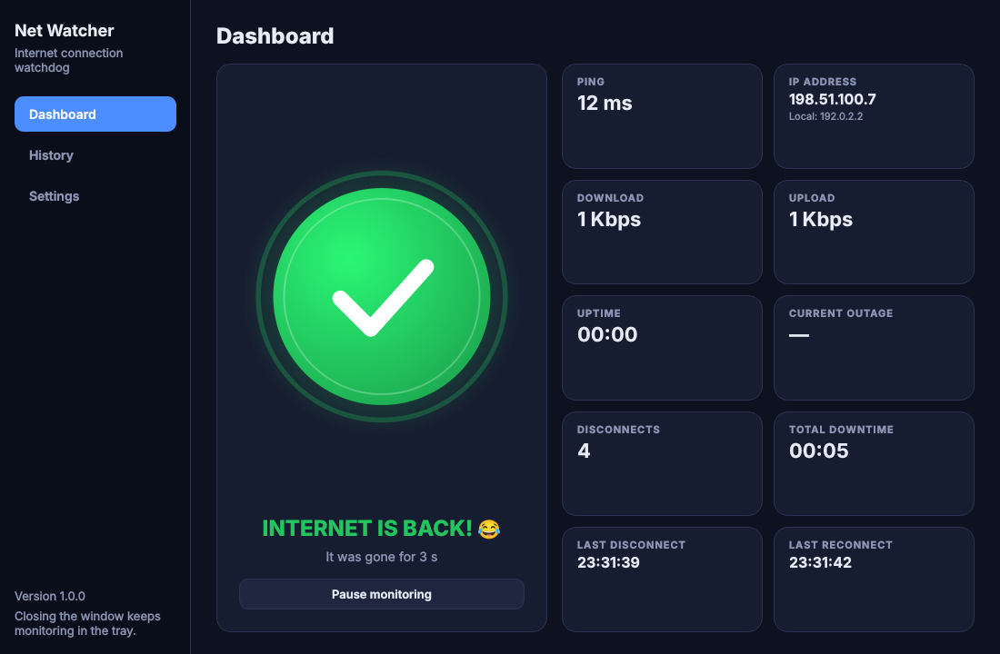
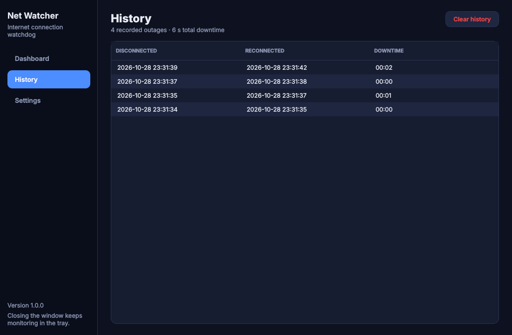
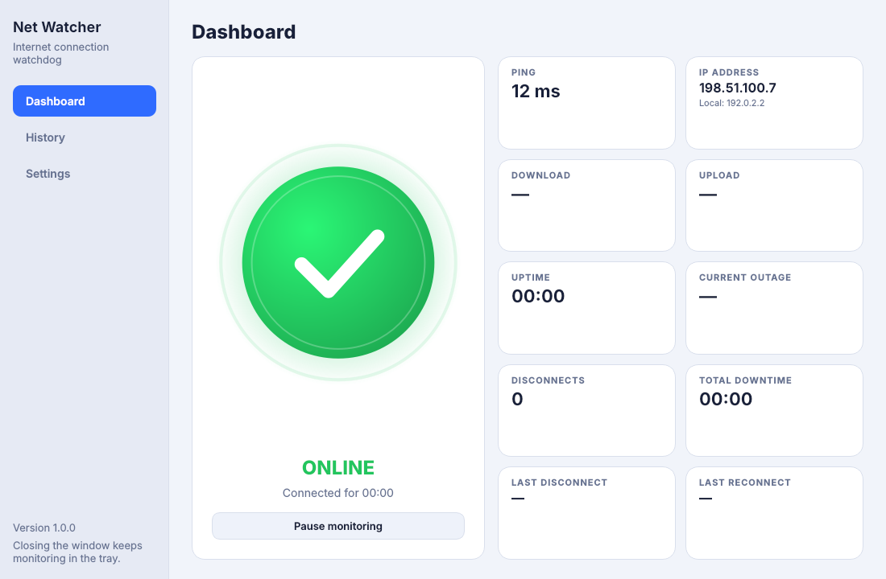

<div align="center">


# Net Watcher

**A desktop watchdog for your internet connection.**
It quietly checks your connection in the background and makes a scene the moment it drops — and again when it comes back.

[](https://github.com/niruvai/net-connection-monitor/actions/workflows/tests.yml)

-41CD52?logo=qt&logoColor=white)

[](LICENSE)

[Features](#features) · [Screenshots](#screenshots) · [Quick start](#quick-start) · [How it works](#how-it-works) · [Building installers](#building-installers) · [Updates](#signed-auto-updates) · [বাংলা](#বাংলায়-সংক্ষেপে)

</div>

---

## Why?

Wi-Fi drops silently. You notice ten minutes later when a video call froze, a download died, or a message never went out.
**Net Watcher** tells you *immediately* — with a loud horn and a red screen when the connection goes, and a laugh, a
green screen and a "you were offline for 3 min 12 s" report when it returns. Every outage is logged, so you also get
hard evidence for your ISP.

## Features

| | |
|---|---|
| 🔍 **Reliable detection** | 7 parallel probes (TCP to public IPs, raw DNS queries to public resolvers, HTTPS `generate_204`). The first success wins, so a single slow server never causes a false alarm. |
| 🧠 **No false alarms** | An outage is declared only after **2 consecutive failed cycles**; recovery needs just one success. Alerts fire on state *changes*, never on single checks. |
| 🔊 **Loud, once-per-event alerts** | Offline: horn sound, red indicator, **INTERNET DISCONNECTED**, live downtime timer. Back online: laugh sound, green indicator, **INTERNET IS BACK! 😂**, outage duration. |
| 📊 **Live dashboard** | Status, ping, live download/upload, uptime, current outage, disconnect count, total downtime, public + local IP, last disconnect/reconnect. |
| 🗂️ **Outage history** | Every outage with start, end and duration — persisted to disk and clearable. |
| ⚙️ **Configurable** | Check interval, sounds on/off, master volume, **custom sounds** (WAV/MP3/OGG/FLAC/M4A), desktop notifications, auto-start monitoring, start at login, dark/light theme, minimize to tray. |
| 🖥️ **System tray** | Colour-coded tray icon (online / offline / paused) with Show, Pause/Resume, Enable/Disable sounds, Exit. |
| 💤 **Smart about real life** | Re-checks instantly when you switch Wi-Fi, plug in a cable or connect a VPN; ignores stale failures after the laptop wakes from sleep. |
| 🔐 **Signed auto-updates** | Ed25519-signed release manifest, SHA-256 + size checked downloads, HTTPS only, no downgrades. |
| 🧰 **Production-ready** | Single-instance lock, rotating log file, graceful shutdown, `--self-test` for packaged builds, 119 automated tests. |

## Screenshots

<table>
  <tr>
    <td align="center"><br><sub>Connection lost — red alert with live downtime</sub></td>
    <td align="center"><br><sub>Back online — outage duration report</sub></td>
  </tr>
  <tr>
    <td align="center"><br><sub>Outage history</sub></td>
    <td align="center"><br><sub>Light theme</sub></td>
  </tr>
</table>

## What you can use it for

- **Know the second your internet drops** while you work, game, stream or wait on a long download.
- **Collect proof for your ISP** — a timestamped list of every outage and the total downtime.
- **Watch an unstable connection** (mobile hotspot, shared Wi-Fi, a new router) and see how often it actually fails.
- **Leave it running in the tray** on an office or home PC and start it automatically at login.
- **Use it as a reference project** for a clean PySide6 desktop app: background threads, Qt signal bridges, a pure-Python core, tests with offscreen Qt, PyInstaller packaging and a secure updater.

## Quick start

**Requirements:** Python 3.10 or newer.

```bash
git clone https://github.com/niruvai/net-connection-monitor.git
cd net-connection-monitor

python -m venv .venv
source .venv/bin/activate          # Windows: .venv\Scripts\activate
pip install -r requirements.txt

python main.py                     # add --minimized to start hidden in the tray
```

### Command-line options

| Option | Description |
|---|---|
| `--minimized` | Start hidden in the system tray |
| `--self-test` | Verify the installation (sounds, icons, TLS, signature checks) and exit — used by build scripts |
| `--allow-multiple` | Skip the single-instance check |

### Run the tests

```bash
pip install -r requirements-dev.txt
python -m pytest
```

Tests use Qt's offscreen platform, so no display or audio device is needed.

## How it works

```text
            ┌────────────────────────────── background thread ──────────────────────────────┐
 every 2 s  │ ConnectivityChecker ──► 7 probes in parallel ──► first success = online + ping  │
            │            │                                                                   │
            │            ▼                                                                   │
            │ ConnectionStateMachine  (2 failures → OFFLINE, 1 success → ONLINE)             │
            └────────────┬───────────────────────────────────────────────────────────────────┘
                         │ transition (Qt signal)
                         ▼
               AppController ──► sound · notification · history · dashboard · tray icon
```

1. Every interval, `ConnectivityChecker` starts all probes at once and returns on the first success; that probe's
   latency is the displayed ping. Probes use raw IPs, so a DNS-only outage does not look like a full outage.
2. `ConnectionStateMachine` needs **2 consecutive failed cycles** to go OFFLINE (the second check runs after ~0.75 s
   instead of a full interval, so detection stays fast) and **1 successful cycle** to go back ONLINE.
3. A change in network adapters or addresses (Wi-Fi switch, VPN, cable) wakes the loop for an immediate re-check;
   a long gap between checks (laptop sleep) discards stale failure counts.
4. Download/upload are live rates from the OS interface counters — no test traffic is generated.

If the app starts while already offline it raises the offline alert once; starting online is silent. Pausing
freezes the state; if the connection came back meanwhile, the reconnect alert fires on resume.

## Project structure

```text
main.py                 entry point: wires the app together
core/                   pure Python, no Qt — all the rules
  connectivity.py         probes + ConnectivityChecker (parallel, first success wins)
  state_machine.py        debounced ONLINE/OFFLINE logic
  monitor.py              background thread (pause/resume, adapter-change + sleep handling)
  session.py              uptime / downtime / counters
  history.py, settings.py JSON persistence
  version.py              the single source of the app version
  update/                 manifest + signature checks, secure download, installer hand-off
services/               glue between core and the OS / Qt
  controller.py           AppController: transitions → sounds, notifications, history, UI signals
  monitor_service.py      thread → Qt signal bridge
  audio_service.py        QSoundEffect (WAV) / QMediaPlayer (MP3, OGG, …)
  notification_service.py tray notifications
  autostart_service.py    Registry (Windows) / LaunchAgent (macOS) / .desktop (Linux)
  update_service.py       schedules update checks, drives download/install
  network_info.py         live throughput, interface fingerprint, local + public IP
ui/                     widgets only — they render controller signals
utils/                  paths, logging, formatting
assets/                 icons and sounds
tools/                  regenerate sounds/icons; release.py signs and publishes updates
packaging/              PyInstaller spec, build scripts, installer definitions
tests/                  119 tests (core logic, services and UI)
```

> **Rule of thumb:** change *what counts as offline* in `core/`, *what happens when it changes* in
> `services/controller.py`, and *how it looks* in `ui/`.

## Customisation

**Sounds** — Replace `assets/sounds/offline.wav` / `reconnect.wav`, or pick your own files in
**Settings → Sounds** (WAV, MP3, OGG, FLAC, M4A). A missing custom file falls back to the bundled one.
Regenerate the synthesized defaults with `python tools/generate_sounds.py`.

**Icons** — `python tools/make_icons.py` redraws everything in `assets/icons/` from `ui/icons.py`. Drop in your own
`tray_online.png`, `tray_offline.png`, `tray_paused.png` or `tray_unknown.png` to restyle the tray.

**Data location**

| | Windows | macOS |
|---|---|---|
| Settings, history, logs | `%APPDATA%\NetWatcher\` | `~/Library/Application Support/NetWatcher/` |

Set the `NET_WATCHER_HOME` environment variable to use a different folder.

## Building installers

Build on the OS you are targeting (PyInstaller does not cross-compile). Install `requirements-dev.txt` first.

### Windows — `.exe` and installer

```powershell
.\packaging\build_windows.ps1                 # add -SkipInstaller to stop after the .exe
```

Runs the tests, then PyInstaller → `dist\NetWatcher\NetWatcher.exe`. With [Inno Setup 6](https://jrsoftware.org/isinfo.php)
installed it also produces `dist\installer\NetWatcher-Setup-<version>.exe` with desktop-shortcut and start-at-sign-in options.

### macOS — `.app` and `.dmg`

```bash
./packaging/build_macos.sh            # → dist/Net Watcher.app and dist/NetWatcher-<version>-<arch>.dmg
./packaging/build_macos.sh --no-dmg   # only the .app
./packaging/create_dmg.sh             # only the DMG, from an existing .app
```

The app is ad-hoc signed by default (right-click → Open on first launch). For distribution set
`CODESIGN_IDENTITY="Developer ID Application: …"` and optionally `NOTARY_PROFILE=<notarytool profile>`.

The version lives only in `core/version.py`; the app, spec, installer and DMG script all read it from there.
Both build scripts finish by running the packaged app with `--self-test` and fail if it does not pass.

## Signed auto-updates

Net Watcher checks for a new release 20 s after start and every 6 hours (can be switched off in **Settings → Updates**).
Nothing is downloaded or installed until the user clicks **Download and install**.

**Security model**

- `latest.json` is signed with an Ed25519 key; the app only trusts public keys compiled into it.
- Every download must match the SHA-256 hash and exact size from the signed manifest, otherwise it is deleted.
- HTTPS only (plain HTTP only for `localhost` testing); redirects to insecure URLs are refused.
- The server never chooses file types or local file names, and older versions can never be installed as "updates".
- User data lives outside the install folder and is never touched by installers.

**One-time setup**

```bash
python tools/release.py keygen --out ~/secrets/net-watcher-release.key   # keep it private and backed up
```

Put the printed public key into `PUBLIC_KEYS` and the HTTPS URL of your manifest into `FEED_URL` in
`core/update/config.py` (any static host works, e.g. GitHub Releases `…/releases/latest/download/latest.json`).
Builds without these values still run and simply show "Updates are not configured".

**Publishing a release**

1. Bump `__version__` in `core/version.py` and commit.
2. Build on each target platform (Windows installer, macOS arm64 DMG, macOS x64 DMG).
3. Sign and publish:

   ```bash
   python tools/release.py publish --key ~/secrets/net-watcher-release.key --notes release-notes.md \
       --asset windows-x64=NetWatcher-Setup-1.1.0.exe \
       --asset macos-arm64=NetWatcher-1.1.0-arm64.dmg \
       --asset macos-x64=NetWatcher-1.1.0-x64.dmg \
       --out dist/release
   ```

4. Upload everything in `dist/release/` next to `FEED_URL` — **upload `latest.json` last** so clients never see a
   release whose files are not there yet.

On Windows the update installs silently in place and relaunches; on macOS a helper verifies the new bundle's code
signature and version, swaps the `.app` (rolling back on failure) and reopens it. For local testing set
`NET_WATCHER_UPDATE_FEED` and `NET_WATCHER_UPDATE_PUBKEY` and serve `dist/release` with `python -m http.server`.

## Privacy

Net Watcher sends no analytics. Its only network traffic is the tiny connectivity probes, a public-IP lookup over HTTPS
(api.ipify.org with fallbacks, on reconnect and every 5 minutes while online) and — if you configure it — update checks
to your own `FEED_URL`.

## Notes and limits

- Download/upload show what your computer is using right now; this is not a speed test.
- If the system tray is unavailable (some Linux desktops), closing the window quits the app.
- Desktop notifications go through the tray icon, so they appear only while it is visible.
- On macOS, the first notification may ask you to allow notifications for Net Watcher in System Settings.
- Unsigned installers trigger Windows SmartScreen / macOS Gatekeeper warnings; code signing is recommended for public distribution.

## বাংলায় সংক্ষেপে

**Net Watcher** একটি ডেস্কটপ অ্যাপ যা ব্যাকগ্রাউন্ডে প্রতি ২ সেকেন্ডে আপনার ইন্টারনেট কানেকশন চেক করে।

- ইন্টারনেট চলে গেলে সাথে সাথে **জোরে হর্ন বাজে**, স্ক্রিন লাল হয়ে যায় এবং কতক্ষণ ধরে নেট নেই তার লাইভ টাইমার দেখায়।
- নেট ফিরে এলে **হাসির শব্দ** বাজে, স্ক্রিন সবুজ হয় এবং জানায় কতক্ষণ নেট ছিল না।
- প্রতিটি ডিসকানেকশনের সময় ও দৈর্ঘ্য **হিস্টোরিতে সেভ** থাকে — ISP-কে অভিযোগ করার প্রমাণ হিসেবে কাজে লাগে।
- ড্যাশবোর্ডে পিং, ডাউনলোড/আপলোড স্পিড, আপটাইম, মোট ডাউনটাইম, IP অ্যাড্রেস দেখা যায়।
- নিজের পছন্দের সাউন্ড, ডার্ক/লাইট থিম, সিস্টেম ট্রে, কম্পিউটার চালু হলে অটো-স্টার্ট — সব সেটিংসে আছে।
- Windows ও macOS-এর জন্য ইনস্টলার বানানো যায়, এবং নিরাপদ (সাইন করা) অটো-আপডেট সাপোর্ট আছে।

চালানোর জন্য উপরের [Quick start](#quick-start) অংশটি দেখুন।

## Contributing

Issues and pull requests are welcome. Please run `python -m pytest` before opening a PR and keep the
`core/` → `services/` → `ui/` separation intact.

## License

Released under the [MIT License](LICENSE).
